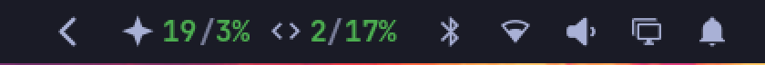
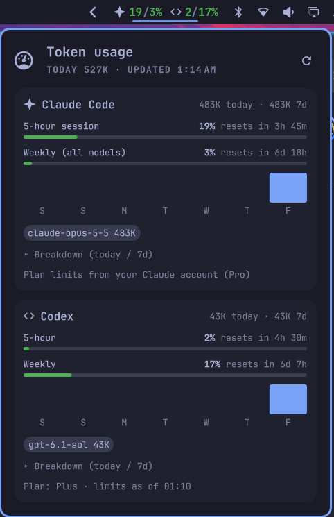
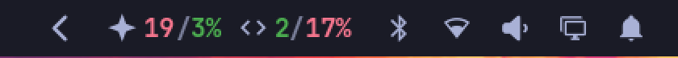
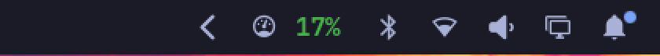
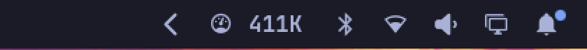
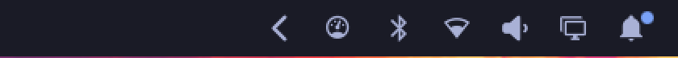

# TokenGauge for Omarchy

An [Omarchy](https://omarchy.org) bar widget that tracks AI token usage and plan
limits. It's the Linux version of the TokenGauge macOS menu bar app.



Each tool gets a badge with its session / weekly % used. Click for the details:



- **Claude Code**: exact session and weekly limits from your Claude account (the
  same source as `/usage`), plus token totals from `~/.claude/projects` logs
- **Codex CLI**: session and weekly rate limits and token totals from
  `~/.codex/sessions` logs
- **Anthropic / OpenAI API** (optional): org-wide usage through Admin API keys
  stored in your keyring

Badges use your theme's green and yellow, then turn red at `warnPercent`:



## Install

You need `python3`. `secret-tool` is only needed for the optional Admin API keys.

```bash
omarchy plugin add https://github.com/HeyitsTayters/tokengauge-omarchy.git
omarchy plugin enable dev.tayters.tokengauge --section right
```

Update it with `omarchy plugin update dev.tayters.tokengauge`.

## Remove

```bash
omarchy plugin remove dev.tayters.tokengauge
rm -rf ~/.cache/tokengauge
```

If you stored Admin API keys, clear them too:

```bash
secret-tool clear service dev.tokengauge.apikeys account anthropic-admin
secret-tool clear service dev.tokengauge.apikeys account openai-admin
```

## Use

- **Click** opens the panel, **right-click** refreshes
- Keyboard: ↑/↓ scroll, `r` refreshes

Keybindings can drive it through the shell:

```bash
omarchy-shell dev.tayters.tokengauge toggle    # also: open, close
omarchy-shell dev.tayters.tokengauge refresh
omarchy-shell dev.tayters.tokengauge status    # the latest snapshot as JSON
```

`python3 tokengauge.py` prints a snapshot in the terminal.

## Settings

Add these to the widget's entry in `~/.config/omarchy/shell.json`. They apply on
save.

```json
{ "id": "dev.tayters.tokengauge", "display": "highest", "warnPercent": 90 }
```

| Setting | Default | Meaning |
|---|---|---|
| `display` | `"badges"` | `badges`, `highest` (highest limit %), `tokens` (tokens today) or `icon` |
| `warnPercent` | `80` | Turn red from this %. Yellow starts at 50% |
| `refreshSeconds` | `60` | How often to read the logs, at least 15 |
| `claude` | `true` | Track Claude Code |
| `codex` | `true` | Track Codex CLI |
| `accountLimits` | `true` | Use exact limits from your Claude login (see below) |
| `blockBudget` | `0` | 5-hour token budget for % gauges when account limits are off |
| `weeklyBudget` | `0` | Rolling 7-day token budget, likewise |
| `anthropicApi` | `false` | Show Anthropic org usage |
| `openaiApi` | `false` | Show OpenAI org usage |

Token counts exclude cache reads, except in the breakdown.

### Display modes

| `display` | Shows |
|---|---|
| `badges` |  |
| `highest` |  |
| `tokens` |  |
| `icon` |  |

### Admin API keys

Store the keys in your keyring, then turn on `anthropicApi` or `openaiApi`:

```bash
secret-tool store --label="TokenGauge Anthropic" service dev.tokengauge.apikeys account anthropic-admin
secret-tool store --label="TokenGauge OpenAI" service dev.tokengauge.apikeys account openai-admin
```

## What it sends

Log files are read locally and never leave your machine.

With `accountLimits` on, TokenGauge reads the login in
`~/.claude/.credentials.json` and uses it to ask `api.anthropic.com` for your plan
limits, at most once every 5 minutes. The token is never refreshed, so this can't
sign Claude Code out, and it's never written anywhere. The endpoint is
undocumented and may change. Set `accountLimits` to `false` to make no requests
to it.

The result is cached in `~/.cache/tokengauge/`, shared by the widget on each
monitor. If the endpoint is rate-limited, TokenGauge backs off for up to an hour
and shows the last result with a note.

The Admin APIs are only called when you turn them on, at most once every 5
minutes per bar.

## Tests

```bash
python3 -m unittest discover tests
```

## License

[MIT](LICENSE)
