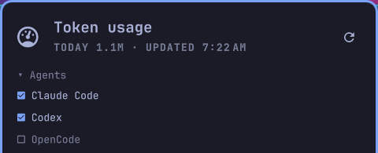

# TokenGauge for Omarchy

An [Omarchy](https://omarchy.org) bar widget that tracks AI token usage and plan
limits. It's the Linux version of the TokenGauge macOS menu bar app.


Each agent gets a badge with its session / weekly % used. Click for the details:


- **Claude Code and Codex**: plan limits, plus token totals and a breakdown from
  their logs in `~/.claude/projects` and `~/.codex/sessions`
- **Every other agent Omarchy tracks**: Grok, Cursor, Copilot, Qwen, OpenCode and
  more appear on their own once you use them, from the same usage data as
  Omarchy's Agents widget
- **Anthropic / OpenAI API** (optional): org-wide usage through Admin API keys
  stored in your keyring

Agents without plan limits show today's tokens on the bar, and only on days you
use them.

Badges use your theme's green and yellow, then turn red at `warnPercent`:


## Install

You need `python3`. `secret-tool` is only needed for the optional Admin API keys.

```bash
omarchy plugin add https://github.com/HeyitsTayters/tokengauge-omarchy.git --enable
```

Update it with `omarchy plugin update dev.tayters.tokengauge`.

## Remove

```bash
omarchy plugin remove dev.tayters.tokengauge
rm -rf ~/.cache/tokengauge ~/.local/state/tokengauge
```

If you stored Admin API keys, clear them too:

```bash
secret-tool clear service dev.tokengauge.apikeys account anthropic-admin
secret-tool clear service dev.tokengauge.apikeys account openai-admin
```

## Use

- **Click** opens the panel, **right-click** refreshes
- Keyboard: ↑/↓ scroll, `r` refreshes, `a` opens the agent list

### Choosing agents

Open **Agents** at the top of the panel and click one to show or hide it. A
hidden agent is left out of the bar and the panel, and TokenGauge stops collecting
its usage. With more than one monitor, the other bars catch up at their next
refresh.



Keybindings can drive it through the shell:

```bash
omarchy-shell dev.tayters.tokengauge toggle    # also: open, close
omarchy-shell dev.tayters.tokengauge refresh
omarchy-shell dev.tayters.tokengauge hide opencode    # also: show
omarchy-shell dev.tayters.tokengauge status    # the latest snapshot as JSON
```

`python3 tokengauge.py` prints a snapshot in the terminal.

## Settings

Add these to the widget's entry in `~/.config/omarchy/shell.json`. They apply on
save.

```json
{ "id": "dev.tayters.tokengauge", "display": "highest", "warnPercent": 90 }
```

| Setting | Default | Meaning |
|---|---|---|
| `display` | `"badges"` | `badges`, `highest` (highest limit %), `tokens` (tokens today) or `icon` |
| `warnPercent` | `80` | Turn red from this %. Yellow starts at 50% |
| `refreshSeconds` | `60` | How often to read the logs, at least 15 |
| `claude` | `true` | Track Claude Code |
| `codex` | `true` | Track Codex CLI |
| `omarchyAgents` | `true` | Use Omarchy's usage data (see below). Off shows only Claude Code and Codex |
| `accountLimits` | `true` | Show Claude plan limits (see below) |
| `blockBudget` | `0` | 5-hour token budget for % gauges when Claude limits are off |
| `weeklyBudget` | `0` | Rolling 7-day token budget, likewise |
| `anthropicApi` | `false` | Show Anthropic org usage |
| `openaiApi` | `false` | Show OpenAI org usage |

Claude Code and Codex token counts exclude cache reads, except in the breakdown.
Other agents report one total that includes them, so they have no breakdown and
can look larger.

### Display modes

| `display` | Shows |
|---|---|
| `badges` |  |
| `highest` |  |
| `tokens` |  |
| `icon` |  |

### Admin API keys

Store the keys in your keyring, then turn on `anthropicApi` or `openaiApi`:

```bash
secret-tool store --label="TokenGauge Anthropic" service dev.tokengauge.apikeys account anthropic-admin
secret-tool store --label="TokenGauge OpenAI" service dev.tokengauge.apikeys account openai-admin
```

## What it sends

Log files are read locally and never leave your machine.

Plan limits and other agents come from the records in
`~/.local/state/omarchy/agents/usage/`. Omarchy's `omarchy-agent-usage-update`
writes them, and it contacts each agent's own service using the login you already
have. Omarchy's Agents widget runs it while it's on your bar. If nothing has
updated the records for 15 minutes, TokenGauge runs it, skipping hidden agents.
Set `omarchyAgents` to `false` to neither read the records nor run the command.

The command is an Omarchy internal rather than a plugin API, so it may change.
If it's missing, `omarchyAgents` is off, or there's no usable record yet (such as
right after installing), TokenGauge falls back to reading Codex limits from its
logs and asking for Claude limits itself. For that it reads
the login in `~/.claude/.credentials.json` and asks `api.anthropic.com` at most
once every 5 minutes, through an undocumented endpoint that may change. The token
is never refreshed, so this can't sign Claude Code out, and it's never written
anywhere. If the endpoint is rate-limited, TokenGauge backs off for up to an hour
and shows the last result with a note.

Set `accountLimits` to `false` to stop Claude limit requests from TokenGauge in
both cases. Omarchy's Agents widget, if it's on your bar, still makes its own.

Cached results are in `~/.cache/tokengauge/`, shared by the widget on each
monitor. Hidden agents are listed in `~/.local/state/tokengauge/hidden.json`.

The Admin APIs are only called when you turn them on, at most once every 5
minutes per bar.

## Tests

```bash
python3 -m unittest discover tests
```

## License

[MIT](LICENSE)
